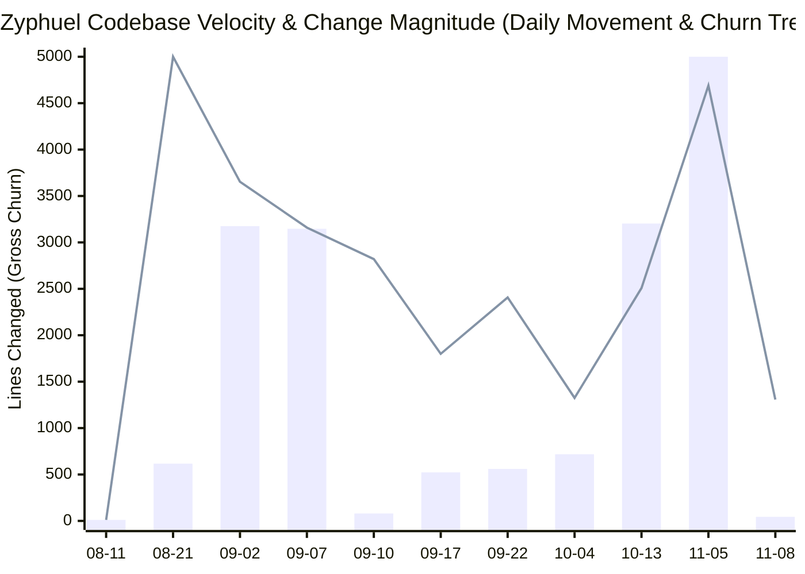
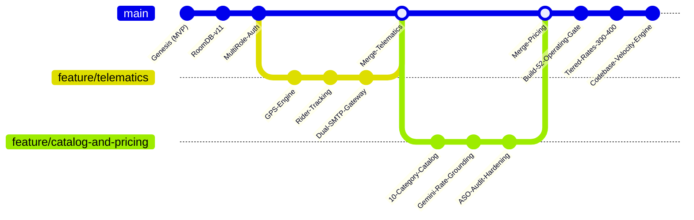

# 🚚 Zyphuel Platform (Android v2.6.4 • Release 2026)

<div align="center">
  
  <h3>Pakistan's Premier On-Demand Fuel & Clean Energy Ecosystem</h3>
  <p><b>Version 2.6.4.0.0.40 (Build 68) • Target SDK 36 • Android 15/16 Ready • Jetpack Compose Material 3 • Room DB v13 • Real-Time Dual Notifications</b></p>

  <p>
    <a href="https://github.com/daniyal44/Zyphuel-App"></a>
    <a href="https://github.com/daniyal44/Zyphuel-App/commits/main"></a>
    <a href="https://github.com/daniyal44/Zyphuel-App/commits/main"></a>
    <a href="https://developer.android.com"></a>
  </p>
</div>

---

<!-- START_VELOCITY_DASHBOARD -->
### 📈 Real-Time Trading-Style Codebase Velocity & Movement Engine

> **Architecture:** Pure Code-Based Dynamic Visualization (Zero Static SVG Files)  
> **Engine Scope:** Multi-timeframe tracking across **Daily (1D)**, **Weekly (1W)**, and **Monthly (1M)** buckets.  
> **Code Magnitude Evaluation:** Dynamically analyzes git code churn, line additions/deletions, files changed, and categorizes every update as a **Major Shift**, **Moderate Shift**, or **Minor Shift**.  
> **Last Synchronized:** <font color="#10b981"><b>2026-11-08</b></font> • **App Version:** <font color="#10b981"><b>v2.6.4.0.0.40 (Build 68)</b></font>

```text
=================================================================================================================ZYPHUEL REAL-TIME TRADING-STYLE CODEBASE VELOCITY & MOVEMENT TERMINAL
Engine: Dynamic Code Churn • Push Cadence Intervals • Scale of Change Classification (Major vs. Minor Shifts)
=================================================================================================================APP VERSION: v2.6.4.0.0.40 (Build 68)   | TOTAL COMMITS: 116   | ACTIVE CODING DAYS: 31
CODE CHURN : +88,230 / -18,193 lines  | GROSS IMPACT : 106,423 lines | MAJOR SHIFTS: 52 (45%)
PUSH CADENCE: Avg ~22.3h per push     | FASTEST INTERVAL: 0m      | MAX COOLDOWN: 10.6d
MOMENTUM   : ▲ BULLISH ACCELERATION     | OPERATING GATE: Mon-Thu 8am-8pm, Fri 8am-1pm, Sat-Sun 10am-6pm PKT
------------------------------------------------------------------------------------------------------------------------
SHA      DATE & TIME       INTERVAL  CHURN METER  SCALE OF CHANGE CHURN (+/-)    MOMENTUM TREND    COMMIT SUMMARY
------------------------------------------------------------------------------------------------------------------------
7123a49  2026-11-08 00:12  +11m      ██████████   MAJOR SHIFT     +14/-0         ◄ CONSOLIDATION   fix(ios): add the framework imports the 
c1cbf70  2026-11-07 19:00  Immediate ███░░░░░░░   MINOR SHIFT     +22/-22        ◄ CONSOLIDATION   chore(dashboard): auto-update code-based
e682001  2026-11-08 00:02  +10m      ██████░░░░   MODERATE SHIFT  +23/-7         ◄ CONSOLIDATION   fix(ios): bundle the Firebase plist from
ee89586  2026-11-07 18:52  Immediate ███░░░░░░░   MINOR SHIFT     +18/-18        ◄ CONSOLIDATION   chore(dashboard): auto-update code-based
9dcb0f5  2026-11-07 23:53  +9m       ███░░░░░░░   MINOR SHIFT     +12/-6         ◄ CONSOLIDATION   ci(ios): surface compiler errors as anno
12d79fa  2026-11-07 18:44  +6m       ███░░░░░░░   MINOR SHIFT     +19/-19        ◄ CONSOLIDATION   chore(dashboard): auto-update code-based
6815d84  2026-11-07 23:38  +5m       ██████░░░░   MODERATE SHIFT  +20/-3         ◄ CONSOLIDATION   ci(ios): select the newest Xcode so Fire
e00b87f  2026-11-07 18:33  Immediate ███░░░░░░░   MINOR SHIFT     +21/-21        ◄ CONSOLIDATION   chore(dashboard): auto-update code-based
19a17f8  2026-11-07 23:35  +2m       ███░░░░░░░   MINOR SHIFT     +21/-12        ◄ CONSOLIDATION   ci(ios): report the real package-resolut
1e369c6  2026-11-07 23:34  +3m       ███░░░░░░░   MINOR SHIFT     +23/-23        ◄ CONSOLIDATION   chore: direct push update - Sat 11/07/20
=================================================================================================================```

#### 📊 Dynamic Codebase Churn & Velocity Chart (Mermaid Vector Rendering)


#### 🌿 Architectural Milestone Progression


#### 📋 Codebase Scale & Multi-Timeframe Velocity Metrics
| Metric | Current Status | Codebase Specification |
| :--- | :--- | :--- |
| 🚀 **App Version** | **v2.6.4.0.0.40** | Production Build `68` |
| 🛡️ **Target Android SDK** | **Android 15/16 Ready** | API Level `36` |
| 📦 **Total Lifetime Commits** | **116 Commits** | Inception (<font color="#10b981"><b>2026-08-11</b></font>) to Present (<font color="#10b981"><b>2026-11-08</b></font>) |
| 🔄 **Total Codebase Churn** | **+88,230 / -18,193** | Net Delta: `+70,037` lines across codebase |
| ⚖️ **Shift Magnitude Ratio** | **52 Major • 22 Moderate • 42 Minor** | `45%` Major Architectural Shifts |
| ⏱️ **Push Cadence & Intervals** | **~22.3h Active Cadence** | Min: `0m` • Max Cooldown: `10.6d` |
| 📈 **Movement Momentum** | **▲ BULLISH EXPANSION** | High-velocity momentum across sprints |
| 📅 **Total Active Coding Days** | **31 Days** | `3.7` Avg Commits / Active Day |
| ⚡ **Latest Verified Push** | `7123a49` (<font color="#10b981"><b>2026-11-08</b></font> `00:12`) | `fix(ios): add the framework imports the app actu` |
| 🟢 **Operational Delivery Gate** | **Mon–Thu 8am–8pm, Fri 8am–1pm, Sat–Sun 10am–6pm PKT** | Tiered Rates (Rs. 300–400), 15L Cap, Silent +Rs. 5/L Markup |

<details>
<summary><b>🔍 View Detailed Codebase Shift Ledgers (1D Daily, 1W Weekly &amp; 1M Monthly) (Click to expand)</b></summary>

##### 🗓️ 1M Monthly Macro Volume & Sprint Milestones (Project Start to Present)
| Month | Commits | % Share | Churn (+/-) | Velocity Meter | Shift Classification | Sprint Focus & Core Milestones |
| :--- | :---: | :---: | :---: | :--- | :--- | :--- |
| <font color="#10b981"><b>August 2026</b></font> | `8` | **6.9%** | `+37,630 / -1,506` | `███████████░` | 4 Major / 1 Minor | 🚀 **Genesis & Architecture**: Core Android MVP, Multi-Role Auth (Customer/Rider/Admin), Room DB v11 & Initial Fuel Dispatch |
| <font color="#10b981"><b>September 2026</b></font> | `50` | **43.1%** | `+30,575 / -11,572` | `████████████` | 28 Major / 9 Minor | 🔥 **Marketplace & Telematics**: 10-Category Catalog, Live Rider GPS Telematics, Dual SMTP Email Gateway, PDF Invoices & Interactive Tour |
| <font color="#10b981"><b>October 2026</b></font> | `34` | **29.3%** | `+9,912 / -4,281` | `████░░░░░░░░` | 14 Major / 16 Minor | ⚡ **Security & Operating Gate**: Secret Hardening, Tiered Delivery Fees (300-400 PKR), Silent OGRA Markup, Operating Hours Gate & Code-Based Graph |
| <font color="#10b981"><b>November 2026</b></font> | `24` | **20.7%** | `+10,113 / -834` | `███░░░░░░░░░` | 6 Major / 16 Minor | Sprint evolution & features |

##### 📅 1W Weekly Velocity & Momentum Breakdown
| Week | Commits | Active Days | Churn (+/-) | Velocity Meter | Shift Breakdown | Momentum Trend |
| :--- | :---: | :---: | :---: | :--- | :--- | :--- |
| <font color="#10b981"><b>2026-W46</b></font> | `12` | `2 days` | `+783/-351` | `█░░░░░░░░░` | 2 Major, 8 Minor | **▲ ACTIVE EXPANSION** |
| <font color="#10b981"><b>2026-W45</b></font> | `12` | `3 days` | `+9330/-483` | `███░░░░░░░` | 4 Major, 8 Minor | **▲ ACTIVE EXPANSION** |
| <font color="#10b981"><b>2026-W44</b></font> | `1` | `1 days` | `+798/-20` | `█░░░░░░░░░` | 1 Major, 0 Minor | **▲ ACTIVE EXPANSION** |
| <font color="#10b981"><b>2026-W43</b></font> | `1` | `1 days` | `+1494/-190` | `█░░░░░░░░░` | 1 Major, 0 Minor | **▲ ACTIVE EXPANSION** |
| <font color="#10b981"><b>2026-W42</b></font> | `7` | `2 days` | `+3028/-440` | `█░░░░░░░░░` | 1 Major, 4 Minor | **▲ ACTIVE EXPANSION** |
| <font color="#10b981"><b>2026-W41</b></font> | `25` | `4 days` | `+4592/-3631` | `██░░░░░░░░` | 11 Major, 12 Minor | **▲ ACTIVE EXPANSION** |

##### 📅 1D Daily Push Cadence & Incline/Decline Trends (Recent 12 Active Days)
| Date | Commits | Churn (+/-) | Velocity Meter | Shift Scale Breakdown | Timing of Pushes | Movement Trend |
| :--- | :---: | :---: | :--- | :--- | :--- | :--- |
| <font color="#10b981"><b>2026-11-08</b></font> | `2` | `+37/-7` | `█░░░░░░░░░` | 1 Major, 1 Mod, 0 Min | From `00:02` to `00:12` | **▼ CONSOLIDATION** |
| <font color="#10b981"><b>2026-11-07</b></font> | `10` | `+746/-344` | `█░░░░░░░░░` | 1 Major, 1 Mod, 8 Min | From `23:32` to `19:00` | **▼ CONSOLIDATION** |
| <font color="#10b981"><b>2026-11-06</b></font> | `1` | `+52/-52` | `█░░░░░░░░░` | 1 Major, 0 Mod, 0 Min | At `20:16` | **▼ CONSOLIDATION** |
| <font color="#10b981"><b>2026-11-05</b></font> | `7` | `+8780/-321` | `███░░░░░░░` | 2 Major, 0 Mod, 5 Min | From `15:44` to `18:26` | **▲ BULLISH SURGE** |
| <font color="#10b981"><b>2026-11-03</b></font> | `4` | `+498/-110` | `█░░░░░░░░░` | 1 Major, 0 Mod, 3 Min | From `17:57` to `17:37` | **▼ CONSOLIDATION** |
| <font color="#10b981"><b>2026-10-24</b></font> | `2` | `+2292/-210` | `█░░░░░░░░░` | 2 Major, 0 Mod, 0 Min | From `03:47` to `14:07` | **◄ ACCUMULATION** |
| <font color="#10b981"><b>2026-10-13</b></font> | `2` | `+2841/-362` | `█░░░░░░░░░` | 1 Major, 0 Mod, 1 Min | From `00:20` to `12:27` | **▲ BULLISH SURGE** |
| <font color="#10b981"><b>2026-10-10</b></font> | `8` | `+575/-228` | `█░░░░░░░░░` | 2 Major, 2 Mod, 4 Min | From `00:07` to `18:09` | **▼ CONSOLIDATION** |
| <font color="#10b981"><b>2026-10-09</b></font> | `7` | `+3211/-1981` | `█░░░░░░░░░` | 5 Major, 0 Mod, 2 Min | From `17:40` to `23:35` | **▲ BULLISH SURGE** |
| <font color="#10b981"><b>2026-10-04</b></font> | `10` | `+414/-304` | `█░░░░░░░░░` | 2 Major, 2 Mod, 6 Min | From `00:05` to `08:43` | **▼ CONSOLIDATION** |
| <font color="#10b981"><b>2026-10-03</b></font> | `5` | `+579/-1196` | `█░░░░░░░░░` | 2 Major, 0 Mod, 3 Min | From `22:59` to `19:07` | **◄ ACCUMULATION** |
| <font color="#10b981"><b>2026-09-30</b></font> | `2` | `+428/-210` | `█░░░░░░░░░` | 1 Major, 0 Mod, 1 Min | From `23:59` to `18:58` | **▼ CONSOLIDATION** |

</details>

<!-- END_VELOCITY_DASHBOARD -->

---

## 📌 About Zyphuel
Zyphuel is Pakistan's premier on-demand doorstep delivery platform for **Super Euro-V Petrol, High-Speed Diesel, and High-Octane 97** across Lahore, Punjab. The platform delivers seamless consumer, rider, and admin operations backed by real-time dual email dispatch, biometric security, and 0ms instantaneous order processing.

---

## 🚀 Key Features (v2.6.4.0.0.40 Latest)

* **Real-Time Automated Order Invoice Email Gateway (`RealtimeEmailEngine.kt`)**: Instant HTML invoice email dispatch to customer inbox upon order placement with order details, volumetric items, unit prices, delivery fee, and total payable amount.
* **High-Contrast Pure Black Typography**: WCAG AAA compliant text styling across Profile Settings, Drawer navigation, category cards, and modal dialogs ensuring effortless readability in all lighting conditions.
* **10-Category Marketplace Navigation (`CategoryComponents.kt` & `CategoryModels.kt`)**: High-speed categorized catalog covering Super Euro-V Petrol, High-Speed Diesel, High-Octane 97, and Automotive Essentials with direct quantity selectors (Doorstep fuel orders strictly capped at 15 Liters per OGRA safety rules; Water & LPG cylinders currently unavailable).
* **Delivery Operating Hours & Order Gate (`DeliveryOperatingHoursManager.kt`)**: Strictly enforces delivery windows (Mon–Thu 08:00 AM–08:00 PM, Fri 08:00 AM–01:00 PM, Sat–Sun 10:00 AM–06:00 PM PKT). Outside these hours, order action buttons are hidden and order placement is blocked.
* **Standardized Pump Rate Markup (`FeeConstants.kt`)**: Official OGRA ex-depot base rates are marked up by a constant `PUMP_RATE_MARKUP = 5.00` Rs./L (`finalRate = ograBase + 5.00`) running silently in the background with only final pump rates displayed to users.
* **Per-Liter Tiered Doorstep Delivery Rate Engine (`FeeConstants.kt`)**: Standardized per-liter tiered delivery fees for fuel (Petrol, Diesel, High-Octane): **1..10L (including 5L, 7L, 10L): Rs. 300**, **11L: Rs. 320**, **12L: Rs. 340**, **13L: Rs. 360**, **14L: Rs. 380**, **15L (Strict Max Cap): Rs. 400**.
* **13-Step Interactive Spotlight Tour Guide (`AppTourGuideDialog.kt`)**: Immersive onboarding walkthrough featuring animated spotlight step overlays, practical tips, and direct feature introductions.
* **Customer Order History Isolation & Admin Master Visibility (`CustomerOrderHistoryScreen`)**: Regular customers strictly view only their own orders with case-insensitive email matching. When logged in as Administrator, `customerOrders` automatically streams `getAllOrdersFlow()`, showing all users' orders and Admin orders with custom badges and full customer identifiers.
* **Official Order Tax Invoice Generation & PDF Download (`InvoiceGenerator.kt`)**: Generates official itemized tax invoices with complete customer, driver, and fare breakdowns. Features native Android `PrintManager` integration for 1-tap "Save as PDF" to phone storage, direct printing, and social sharing via WhatsApp and Email.
* **Admin Order Controls & Self-Delivery Lifecycle (`adminAcceptOrder` & `changeOrderStatus`)**: Admin Dashboard order cards equipped with direct "Accept Order" (with automatic self-delivery assignment if no rider is online), "Start Delivery 🚚", "Mark Delivered ✅", and "Decline Order".
* **Triple-Party Gmail Order Dispatch Gateway**: Multi-channel transactional email dispatch supporting direct TLS/SSL Port 465, RFC 3207 STARTTLS Port 587, and serverless Google Apps Script HTTPS relay over Port 443 with Cloud Firestore configuration synchronization.
* **Verified Admin Blue Tick & Permanent Super Admin Guard**: Root Administrator account (`m.daniyalkhan490@gmail.com`) is permanently protected from deletion, resets, or removal across local Room DB and Cloud Firestore, displaying the official **Blue Tick Verified Badge**.
* **Universal Biometric Authentication**: Hardware-backed AndroidX `BiometricPrompt` authentication available for **both Google Sign-In and Manual Email logins**, configurable directly from Profile and Security Settings.
* **Google Play Policy Compliant**: Full support for In-App and Sidebar Account Deletion (`deleteCurrentAccount`), encrypted AES-256 session tokens, SHA-256 password hashing, and OGRA safety compliance.

---

## 🛠️ Tech Stack & Architecture

* **Language**: Kotlin 2.0+ (Jetpack Compose with Material Design 3)
* **Architecture**: MVVM with `MainViewModel` and Kotlin `StateFlow`
* **Local Persistence**: Android Room DB (SQLite) with KSP compiler (v13 schema, `MIGRATION_12_TO_13` preserves user data across updates — <font color="#10b981"><b>2026-10-23</b></font>)
* **Cloud Sync**: Google Cloud Firestore real-time listeners & Firebase Cloud Messaging (FCM)
* **Security & Auth**: Email + password with **PBKDF2-HMAC-SHA256** (120k iterations, per-user salt), AndroidX `BiometricPrompt`, `EncryptedSharedPreferences` (AES-256-GCM via Android Keystore), optional Google OAuth — see [SECURITY.md](SECURITY.md)
* **Location & Sharing**: Google Play Services `FusedLocationProviderClient` (`PRIORITY_HIGH_ACCURACY`) and Android `ACTION_SEND`

---

## ⚙️ Installation, Setup & Environment

### Requirements
- Android Studio (or a JDK 17+ toolchain) and **Gradle 9.5.0** (wrapper included)
- Android SDK **36** (`compileSdk`/`targetSdk` 36, `minSdk` 24)
- JDK 25 works with this toolchain; set `JAVA_HOME` before invoking Gradle

### Clone & build
```bash
git clone https://github.com/daniyal44/Zyphuel-App.git
cd Zyphuel-App
./gradlew :app:assembleDebug        # debug APK
./gradlew :app:testDebugUnitTest    # full JVM/Robolectric suite (54 tests)
```

### Environment configuration (all values are git-ignored)

| Setting | Where | Purpose |
| :--- | :--- | :--- |
| `ADMIN_PASSWORD_HASH` | env var or `app/admin-credentials.properties` | Master admin login hash (`BuildConfig.MASTER_ADMIN_HASH`). Falls back to a default hash only for local/dev builds. |
| `SMTP_APP_PASSWORD` | env var, `local.properties`, or **Firestore `system_config`** | Outbound invoice/receipt mail. No credential is hardcoded in source. |
| `KEYSTORE_PATH`, `STORE_PASSWORD`, `KEY_PASSWORD` | env vars | Release signing. Without a keystore the build falls back to the debug key — never publish that artifact. |
| `MAPS_API_KEY`, `GEMINI_API_KEY` | `.env` (see [.env.example](.env.example)) | Maps tiles and AI features. Placeholders are safe defaults. |
| `google-services.json` | `app/` (git-ignored) | Firebase/Firestore/FCM. Commit only the sanitized `.example` template. |

Nothing above is required for a compile-only build; Firestore-backed features stay dormant until Firebase is configured.

---

## 📦 Build & Release Commands

### 1. Compile Debug Build
```powershell
$env:JAVA_HOME = "C:\Program Files\Eclipse Adoptium\jdk-25.0.4.7-hotspot"; & "C:\Users\mdani\.gradle\wrapper\dists\gradle-9.5.0-bin\bvnork1r7n8i6kp5cnkibsc9q\gradle-9.5.0\bin\gradle.bat" assembleDebug
```

### 2. Generate Google Play Store Release Bundle (`.aab`)
```powershell
$env:JAVA_HOME = "C:\Program Files\Eclipse Adoptium\jdk-25.0.4.7-hotspot"; & "C:\Users\mdani\.gradle\wrapper\dists\gradle-9.5.0-bin\bvnork1r7n8i6kp5cnkibsc9q\gradle-9.5.0\bin\gradle.bat" bundleRelease
```
*Generated output path:* `app/build/outputs/bundle/release/app-release.aab`

---

## 📁 Key Documentation References
* [`SECURITY.md`](SECURITY.md): Auth architecture, PBKDF2 hashing, 4-attempt/5-minute lockout, data isolation, secrets, incident response.
* [`DATABASE.md`](DATABASE.md): Room + Firestore topology, tables, ownership, backup/restore, RPO/RTO, retention.
* [`MIGRATIONS.md`](MIGRATIONS.md): Migration policy, registry, execution, failure recovery and rollback limits.
* [`TESTING.md`](TESTING.md): Test commands and the security, rate-limit, isolation and data-preservation matrix.
* [`changes.md`](changes.md): Release changelog with version numbers, dates and migration notes.
* [`FEATURES_DOCUMENTATION.md`](file:///d:/Games/New%20folder-web/Claude/FEATURES_DOCUMENTATION.md): Comprehensive feature inventory & component specifications (v2.6.4.0.0.40).
* [`ARCHITECTURE.md`](file:///d:/Games/New%20folder-web/Claude/ARCHITECTURE.md): System architecture, layered diagram, and data flow constraints.
* [`PLAY_STORE_ASO_BLUEPRINT.md`](file:///d:/Games/New%20folder-web/Claude/PLAY_STORE_ASO_BLUEPRINT.md): App Store Optimization, keywords, and release assets guide.
* [`bugs.md`](file:///d:/Games/New%20folder-web/Claude/bugs.md): Master bug resolution and verification ledger.
* [`MEMORY.md`](file:///d:/Games/New%20folder-web/Claude/MEMORY.md): Persistent implementation memory and evolution phases.
